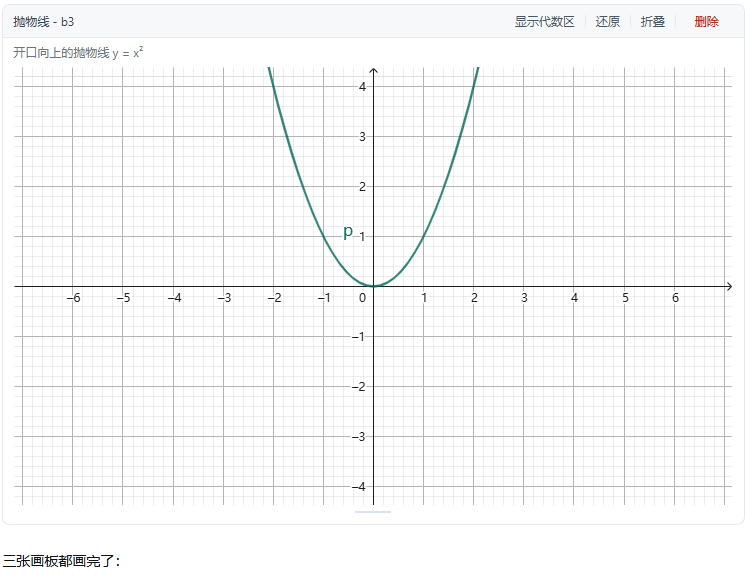

# DSH GeoGebra Chat

在 DeepSeek Harness 的对话里画 GeoGebra。每次作图生成一张独立的快照板，之前的图不会被覆盖。

[DeepSeek Harness](https://github.com/deepseek-ai) · GeoGebra 6 · MIT



> 状态：0.1.0 实验版，已在 DSH `0.2.1-rc.2` 上验证。插件接口还在调整，升级 DSH 后可能需要跟着改。

当前版本完全由 AI（DeepSeek）编写，后续会做人工审查。请按实验版本使用。

English: [README.md](../README.md)

## 背景

一般的"AI 画图"，要么生成一张静态图片，要么只有一块共享画布，后画的图会把前面的盖掉。讲数学题时很别扭：画第二种情况，第一种就没了；上下文一长，模型也开始记不清自己建过哪些对象。

这个插件把每次作图单独存成一张板：

- `create` 总是新建一张板，旧板保持原样；
- 想接着画，就用旧板的 XML 作为底稿生成新板，而不是改旧板；
- 宿主保存 XML、`.ggb` 和对象清单；Agent 每次都从工具读清单，不靠记忆；
- 命令写错了，用 `amend` 在同一回合补发，不会留下失败的板。

## 快速开始

把包装进 DSH 环境后，在 profile 的 patch 里注册：

```yaml
- insert:
    - id: dsh-geogebra-chat
      name: '@normal-git/dsh-geogebra-chat'
```

从源码开发时，直接指向 `src/index.ts`（绝对路径）：

```yaml
- insert:
    - id: dsh-geogebra-chat
      name: '<path-to-plugin>/src/index.ts'
```

启动：

```bash
dsh --profile <name> --patch <path-to-patch>.yml web --port 3099 --no-open
```

不需要配置 GeoGebra，默认从 CDN 加载。

## 使用

直接对 Agent 说人话：

> 画一个边长 2 的正方形，再画它的外接圆。

Agent 调用 `geogebra_create`，对话里出现一张卡片。卡片上可以：

| 操作 | 说明 |
|---|---|
| 折叠 / 展开 | 折叠状态按会话和板号记住 |
| 拖底边 | 调整画板高度 |
| 显示代数区 | 打开 GeoGebra 左侧代数栏 |
| 还原 | 回到 Agent 生成的版本；再撤销一次回到你改过的样子 |
| 删除 | 需要确认，删除后留一条"已被删除" |
| 滚轮 | 悬停即可缩放 |

继续画：

> 在这个正方形里画一条对角线。

Agent 会先调 `geogebra_check`，再基于旧板新建一张板。

## 工具

| 工具 | 作用 |
|---|---|
| `geogebra_create` | 新建板（必须起名，可 `from` 旧板） |
| `geogebra_amend` | 本轮内补发或修正命令，已有对象保留 |
| `geogebra_commit` | 提前冻结草稿 |
| `geogebra_check` | 用户改了什么，以及当前清单 |
| `geogebra_inspect` | 某个对象的定义或数值 |
| `geogebra_rename` | 改名（编号不变） |
| `geogebra_list` | 列出本会话的板 |
| `geogebra_export` | 导出 `.ggb`（当前版或 Agent 原版） |
| `geogebra_delete` | 删除板（只在用户要求时） |

工具返回的是 GeoGebra 自己的对象清单（标签、类型、定义、文本），不返回 XML 或图片，避免占满上下文。

## 工作原理

```
Agent ── geogebra_create ──▶ 宿主板仓库（XML / .ggb / 对象清单）
                                   │
                                   ▼
                        对话节点：一张 board 卡片
                                   │
                            iframe 里的 GeoGebra
```

- 板记录是 JSON，存在 `<DSH_HOME>/geogebra/boards/<session>/`；
- 卡片只是渲染器，卸载卡片、刷新页面、重启 DSH 都不会丢板；
- 一张板会经历 `creating` → `draft`（本轮可改）→ `final`（冻结）；
- 板号只增不减，删除后也不复用，避免新板撞到旧卡片的节点。

## 限制

- GeoGebra 从 `geogebra.org` 加载；离线或内网需要自备本地包，这个配置项还没做。
- 目前只能导出 `.ggb`。PNG、SVG、PDF 需要画板可见，计划中。
- `<DSH_HOME>/geogebra/boards/` 下的数据不会随插件卸载自动删除。

## 开发

```bash
pnpm install
pnpm build        # lib/index.js + lib/client.js
pnpm watch        # 开发时增量构建
```

| 路径 | 内容 |
|---|---|
| `src/index.ts` | 宿主半：工具、系统提示词、HTTP 路由 |
| `src/boards.ts` | 板仓库：创建、修正、冻结、回执、持久化 |
| `src/command-lint.ts` | 指令名检查和白色对象拦截 |
| `src/client/index.tsx` | 浏览器半：iframe、卡片、对话节点 |
| `src/command-names.json` | 从官方手册生成的指令名 |
| `scripts/` | 构建和开发探针 |

## Roadmap

- [ ] PNG / SVG / PDF 导出
- [ ] 离线 GeoGebra 包
- [ ] 侧栏"继续画"
- [ ] 按 app 限制可用指令
- [ ] 更多自动化测试

## 许可

插件以 MIT 开源，见 [LICENSE](../LICENSE)。

GeoGebra 由 International GeoGebra Institute 按 [GeoGebra License](https://www.geogebra.org/license) 授权。本仓库不包含 GeoGebra，默认从官方 CDN 加载。第三方声明见 [NOTICE](../NOTICE)。

开发由 AI 辅助，提交信息带 `AI-Generated: true`。
